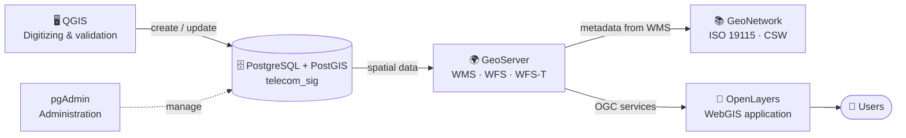
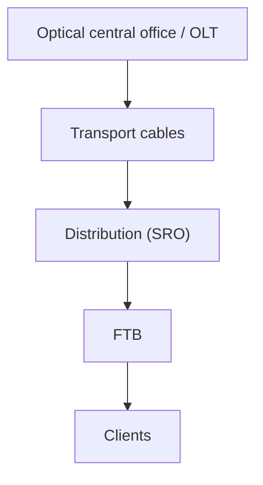

# 📡 Telecommunications Access Networks, GIS & WebGIS

### Engineering Internship Report — Tunisie Telecom, Regional Directorate of Mahdia

  

The report is written in French · 31 pages · 3 chapters

---

## 🧾 About the Internship

| | |
|---|---|
| 🏢 **Host organization** | Tunisie Telecom |
| 📍 **Location** | Regional Directorate of Mahdia, Tunisia |
| 🗺️ **Department** | Geographic Information Systems (GIS) service |
| 🎓 **Institution** | National Engineering School of Tunis (ENIT) — ICT Department |
| 👩‍💻 **Intern** | Hanin EDHIB — Class 1 TEL 1 |
| 👨‍🏫 **Supervisor** | Mr. Mohamed NEGZAOUI |
| 📅 **Period** | July 1 – July 31, 2026 |
| 📘 **Type** | First-year engineering internship (*stage ouvrier*) |

## 🔎 Summary

This one-month internship took place in the GIS service of Tunisie Telecom's Regional Directorate of Mahdia. It combined three activities:

1. **Field observation** of the access network (copper, GPON and AirPON equipment) with the deployment team.
2. **Contribution to the regional GIS** by entering network equipment from technical plans.
3. **A self-built local GIS/WebGIS environment** that reproduces the architecture of a complete GIS stack, from spatial database to web map.

The local environment was built to understand each stage of geographic data management, since access to the production system is restricted for confidentiality reasons.

## 📚 Report Content

| # | Chapter | What it covers |
|:-:|---|---|
| **1** | **Host organization and internship context** | Tunisie Telecom, the Regional Directorate of Mahdia, the GIS service, its missions, data workflow and technical environment |
| **2** | **Access network analysis in a GIS environment** | Evolution from copper to fiber, field equipment, and how copper, GPON and AirPON networks are represented in the GIS |
| **3** | **Building a GIS/WebGIS environment** | Contribution to the regional GIS, then design and implementation of a local PostGIS, GeoServer, QGIS, GeoNetwork and OpenLayers stack |

### 🌐 Access network technologies studied

| Technology | Principle | Observed in the field |
|---|---|:-:|
| **Copper (ADSL / VDSL)** | Tree architecture from the main distribution frame to the subscriber | ✅ |
| **FTTH P2P** | One dedicated fiber per subscriber from the NRO | — |
| **GPON** | One fiber shared among subscribers through passive optical splitters | ✅ |
| **AirPON** | GPON-based deployment using cascaded Hub-Box, Sub-Box and End-Box enclosures, mostly on poles | ✅ |

### 🧱 Network equipment covered

| Equipment | Role |
|---|---|
| **IPMSAN** | Active access node for the copper network (telephony and broadband) |
| **PC** | Concentration point: last distribution level before copper subscribers |
| **OLT** | Active optical equipment that emits the signal, located at the central office |
| **NRO** | Optical connection node housing OLTs and patch panels |
| **SRO** | Optical sub-distribution cabinet, generally hosting splitters |
| **PBO / FAT** | Last optical connection point before the subscriber, contains a splice cassette |
| **Hub-Box / Sub-Box / End-Box** | Three-level AirPON distribution hierarchy |
| **Pull chambers** | Underground chambers shared by copper and fiber cables |

## 🗺️ Local GIS/WebGIS Environment

### Architecture

### Data model

The database mirrors the hierarchical organization of the fiber network observed at Tunisie Telecom.

| Table | Content |
|---|---|
| `centrale_optique` | Optical central offices |
| `olt` | Optical Line Terminals |
| `sro` | Optical sub-distribution cabinets |
| `ftb` | Fiber termination boxes |
| `fibre_optique` | Fiber-optic cables (transport and distribution) |
| `pro` | Connection points |
| `clients` | Client locations |

### WebGIS features

- 🗂️ Display and toggle of geographic layers
- 🔍 Inspection of feature attributes by clicking on the map
- ✏️ Add, edit and delete features (via WFS-T)
- 📏 Distance measurement on the map
- 🔄 Automatic refresh after each modification

### OGC and ISO standards used

| Standard | Purpose |
|---|---|
| **WMS** | Serves maps as georeferenced images |
| **WFS** | Gives access to vector features and their attributes |
| **WFS-T** | Allows feature creation, update and deletion |
| **CSW** | Search and retrieval of metadata in a catalog |
| **ISO 19115** | Standard describing geographic resources |

## 🧰 Technologies

## 🎯 Skills Developed

| Domain | Skills |
|---|---|
| 📡 **Telecom networks** | Copper and FTTx access architectures, optical distribution equipment, field observation |
| 🗺️ **GIS** | Network representation, technical plan integration, attribute entry, data quality |
| 🗄️ **Spatial databases** | PostgreSQL/PostGIS modeling, spatial tables, administration with pgAdmin |
| 🌍 **Geospatial services** | Publishing OGC services (WMS/WFS) and documenting data with metadata |
| 🖥️ **Web mapping** | Interactive map development with OpenLayers |
| 🤝 **Professional** | Rigor, autonomy, teamwork, respect of company procedures |

## 🔒 Scope & Confidentiality

> [!IMPORTANT]
> - The `telecom_sig` environment is a **learning and demonstration setup**. It is **not** Tunisie Telecom's production GIS infrastructure.
> - The data used in the local environment is for demonstration purposes only. No confidential network data is published in this repository.
> - Tunisie Telecom's production system is based on ArcGIS Enterprise. The local stack uses open-source tools.

## 👩‍💻 Author

**Hanin EDHIB**
ICT Engineering student — Telecommunications
National Engineering School of Tunis (ENIT), University of Tunis El Manar

🙏 *Thanks to Mr. Mohamed Negzaoui, the Tunisie Telecom team in Mahdia, and ENIT for their guidance and support.*

